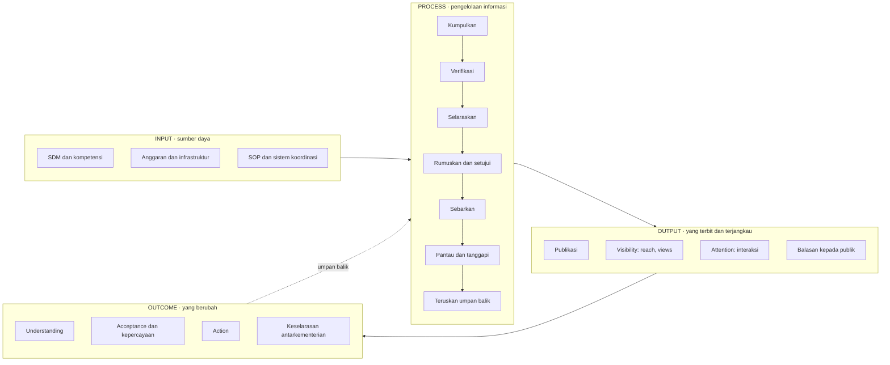
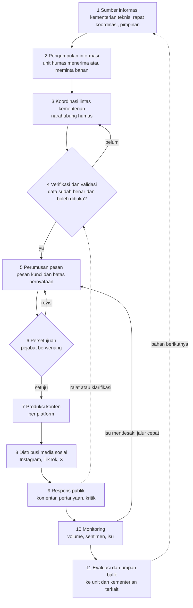

# Kerangka Kinerja Komunikasi Pemerintah untuk Kementerian Koordinator

> **Status: rancangan model, belum divalidasi, bukan standar resmi pemerintah.**
> Disusun 12 November 2026 sebagai tahap 1 modul "Kinerja Komunikasi Pemerintah"
> (lihat `docs/sesi-2026-11-12-situs-publikasi-dan-kinerja-komunikasi.md`).
> Dokumen ini berisi kerangka, indikator, instrumen, dan model skor. Dokumen ini **tidak**
> berisi hasil penilaian terhadap kementerian mana pun; belum ada data yang dinilai.
>
> Anggapan kerja yang dipakai karena belum dijawab pemilik produk (semuanya bisa diganti):
> (1) kasus percontohan = Kemenko Polkam; (2) data yang tersedia = data publik saja, tanpa
> ekspor insight dari humas; (3) tujuan = bahan kuliah dan artikel, sekaligus rancangan modul
> platform; (4) mulai dari dokumen kerangka, kode menyusul.
>
> Cara membaca: setiap bagian memisahkan **Fakta** (bisa dicek di sumber), **Tafsir**
> (penilaian penyusun), dan **Saran** (usulan tindakan).

Daftar isi: 1 Ringkasan eksekutif · 2 Konsep · 3 Karakteristik Kemenko · 4 Kerangka ·
5 Matriks indikator · 6 Instagram, TikTok, X · 7 Arus informasi internal · 8 Metodologi audit ·
9 Model penilaian · 10 Rancangan dashboard · 11 Rekomendasi · 12 Referensi ·
Lampiran A–E (instrumen)

---

## 1. Ringkasan eksekutif

1. **Yang dinilai.** Kinerja komunikasi sebuah Kementerian Koordinator (Kemenko) dinilai pada
   empat dimensi yang dipisah tegas: **Input** (sumber daya), **Process** (cara informasi
   dikumpulkan, diselaraskan, disetujui, disebarkan, dan ditanggapi), **Output** (apa yang
   terbit dan berapa yang menjangkau orang), dan **Outcome** (apa yang berubah pada publik dan
   pada keselarasan antarkementerian).
2. **Mengapa Kemenko berbeda.** Kemenko tidak memiliki program sektoral sendiri. Tugasnya
   menyinkronkan dan mengoordinasikan kementerian lain. Karena itu ukuran yang paling khas
   bukan jumlah pengikut, tetapi **keselarasan pesan lintas kementerian**, **kecepatan
   klarifikasi**, dan **kejelasan siapa sumber resmi** sebuah isu.
3. **Popularitas bukan efektivitas.** Engagement rate tinggi bisa berasal dari konten hiburan
   atau dari kemarahan publik. Kerangka ini menaruh engagement di Output dan tidak pernah
   memakainya sendirian untuk menyimpulkan keberhasilan.
4. **Tiga lapis data.** (a) Data publik yang bisa dihitung siapa saja: unggahan, like,
   komentar, isi komentar. (b) Data milik pemilik akun: reach, impressions, saves, watch time.
   (c) Data internal: SOP, waktu verifikasi, waktu persetujuan. Lapis (b) dan (c) hanya ada
   bila kementerian bersedia memberi. Tanpa itu indikatornya ditulis **"data tidak tersedia"**,
   tidak ditebak.
5. **Skor.** Indikator dinilai 1–5 dengan rubrik tertulis. Bobot dimensi adalah usulan
   (Input 15, Process 30, Output 20, Outcome 35) yang wajib diuji kepekaannya. Skor dimensi
   tidak terbit bila cakupan data kurang dari 60% bobot dimensi itu.
6. **Apa yang bisa dikerjakan platform.** Sisi publik (isi konten, respons publik, sentimen
   komentar, isu dominan, konsistensi pesan, waktu respons). Sisi internal harus diisi dari
   audit, dokumen, dan wawancara lewat formulir.
7. **Langkah berikut.** Uji coba pada Kemenko Polkam dan tiga kementerian yang sudah punya
   proyek di platform (Kemendagri, Kemenlu, Kemenhan), dimulai dari data publik.

---

## 2. Konsep kinerja komunikasi pemerintahan

**Fakta (dari literatur).**

- Komunikasi pemerintah dipelajari sebagai bidang tersendiri karena lingkungannya berbeda dari
  korporasi: tunduk pada politik, hukum keterbukaan informasi, sorotan media, dan tujuan
  layanan publik (Canel & Sanders, 2012; Liu & Horsley, 2007).
- Di organisasi publik, kinerja komunikasi **internal**, **antarlembaga**, dan **eksternal**
  adalah hal yang berbeda dan dipengaruhi faktor berbeda, misalnya kejelasan tujuan dan
  budaya organisasi (Pandey & Garnett, 2006; Garnett, Marlowe & Pandey, 2008).
- Evaluasi komunikasi modern memakai rantai bertahap. Government Communication Service (GCS)
  Inggris memakai Inputs, Outputs, Outtakes, Outcomes, lalu Impact dan Learning (GCS, 2024).
  Macnamara (2015, 2018) menunjukkan bahwa praktik evaluasi sering berhenti di output dan
  menyebut output sebagai hasil.
- Pengukuran kinerja sektor publik memisahkan input, aktivitas/proses, output, dan outcome,
  dan mengingatkan bahwa outcome dipengaruhi banyak hal di luar kendali organisasi
  (Van Dooren, Bouckaert & Halligan, 2015).
- Teori Excellence menempatkan komunikasi dua arah, yaitu mendengar lalu menyesuaikan,
  sebagai ciri fungsi komunikasi yang baik (Grunig, 1992).

**Tafsir.** Dalam kerangka ini, *kinerja komunikasi pemerintahan* berarti: sejauh mana sebuah
lembaga pemerintah, dengan sumber daya yang dimilikinya, mengelola informasi secara tertib dan
selaras, menyampaikannya sehingga dipahami publik, serta menanggapi dan meneruskan umpan balik
publik. Definisi ini sengaja memuat tiga hal yang tidak terlihat dari angka media sosial:
ketertiban proses, keselarasan, dan tindak lanjut.

**Tiga ranah yang tidak boleh dicampur.**

| Ranah | Siapa dengan siapa | Contoh bukti |
|---|---|---|
| Komunikasi internal | Antarunit di dalam Kemenko | SOP, notulen, alur persetujuan konten |
| Komunikasi antarlembaga | Kemenko dengan kementerian/lembaga yang dikoordinasikan | Forum humas, grup koordinasi, narasi bersama, waktu pertukaran data |
| Komunikasi publik | Kemenko dengan warga dan media | Unggahan, siaran pers, balasan komentar |

**Rantai efek pada publik.** Lima tahap yang diminta (Visibility, Attention, Understanding,
Acceptance, Action) dipetakan begini, supaya output dan outcome tidak tertukar:

| Tahap | Arti | Masuk dimensi | Sumber data utama |
|---|---|---|---|
| Visibility | Konten sampai ke layar orang | Output | Reach, impressions, views (pemilik akun) |
| Attention | Orang berhenti dan berinteraksi | Output | Like, komentar, share, watch time |
| Understanding | Orang mengerti isi kebijakan | Outcome | Kuesioner, analisis isi komentar |
| Acceptance | Orang percaya dan menerima | Outcome | Kuesioner; survei probabilistik bila ada |
| Action | Orang bertindak (mendaftar, mematuhi, melapor) | Outcome | Data layanan dari instansi; jarang tersedia |

Padanan dengan istilah GCS: Understanding dan Acceptance = *outtakes*; Action = *outcomes*.
Kerangka ini menggabungkan keduanya di dimensi Outcome karena permintaan awal memakai empat
dimensi.

---

## 3. Karakteristik komunikasi Kementerian Koordinator

**Fakta.**

- Kemenko Polkam diatur dengan Peraturan Presiden Nomor 141 Tahun 2024 (ditetapkan 5 November
  2024, mencabut Perpres 73/2020 tentang Kemenko Polhukam). Kementerian ini menyelenggarakan
  **sinkronisasi dan koordinasi** pelaksanaan urusan kementerian di bidang politik dan keamanan.
- Menurut Perpres 139/2024 tentang penataan tugas dan fungsi kementerian Kabinet Merah Putih,
  Menko Polkam mengoordinasikan Kementerian Dalam Negeri, Kementerian Luar Negeri, Kementerian
  Pertahanan, Kementerian Komunikasi dan Digital, Kejaksaan Agung, TNI, Polri, dan instansi
  lain yang dianggap perlu. (Daftar dibaca dari ringkasan Hukumonline; nomor pasal belum dicek
  langsung di naskah Perpres.)
- Instruksi Presiden Nomor 9 Tahun 2015 tentang Pengelolaan Komunikasi Publik menugaskan
  kementerian/lembaga menyediakan data dan informasi program prioritas, dan menugaskan menteri
  bidang komunikasi mengoordinasikan perencanaan, penyiapan, dan pelaksanaan komunikasi publik
  (narasi tunggal).
- Peraturan Menteri PANRB Nomor 83 Tahun 2012 memuat pedoman pemanfaatan media sosial instansi
  pemerintah. UU Nomor 14 Tahun 2008 mengatur keterbukaan informasi publik.
- Dalam literatur administrasi publik, koordinasi horizontal antarkementerian adalah masalah
  lama: tiap kementerian punya kepentingan, data, dan tempo sendiri (Peters, 1998; Bouckaert,
  Peters & Verhoest, 2010; Christensen & Lægreid, 2007).

**Tafsir: lima ciri yang membedakan Kemenko dari kementerian teknis.**

| Ciri | Akibat bagi komunikasi | Akibat bagi pengukuran |
|---|---|---|
| Tidak memegang program sektoral | Bahan konten berasal dari kementerian lain | Ukur waktu dan mutu pengumpulan informasi |
| Berbicara atas nama beberapa kementerian | Risiko pesan berbeda dengan kementerian teknis | Ukur keselarasan pesan dan pernyataan yang bertentangan |
| Isu lintas sektor dan sering mendadak | Klarifikasi harus cepat tetapi butuh verifikasi ke banyak pihak | Ukur selang waktu dari lonjakan isu ke pernyataan resmi |
| Publik tidak tahu siapa berwenang | Pertanyaan warga sering salah alamat | Ukur kejelasan sumber dan penerusan umpan balik |
| Khalayaknya ganda: publik dan kementerian yang dikoordinasikan | Akun Kemenko bisa ramai di kalangan aparatur tetapi sepi di publik | Jangan menilai dari jumlah pengikut |

**Tafsir: tiga peran yang bisa diambil akun Kemenko.** Peran yang dipilih menentukan indikator
mana yang paling penting.

1. **Penyelaras** (*aligner*): memastikan pesan kementerian teknis tidak bertabrakan.
2. **Penguat** (*amplifier*): meneruskan dan memperluas pesan kementerian teknis.
3. **Juru bicara isu lintas sektor**: berbicara sendiri pada isu yang tidak dimiliki satu
   kementerian.

Peran mana yang benar-benar dijalankan Kemenko Polkam **belum diketahui**; itu salah satu
pertanyaan audit (Lampiran D).

---

## 4. Kerangka Government Communication Performance

Empat blok analisis yang diminta menempati kerangka ini sebagai berikut.

| Blok yang diminta | Letak di kerangka |
|---|---|
| A. Performa komunikasi digital (Instagram, TikTok, X) | Output, dihitung per platform (bagian 6) |
| B. Pengelolaan informasi internal (gathering sampai feedback) | Process (bagian 7) |
| C. Efektivitas komunikasi publik (Visibility sampai Action) | Output (dua tahap pertama) dan Outcome (tiga tahap akhir) |
| D. Efektivitas koordinasi lintas kementerian | Process (mekanisme) dan Outcome (hasilnya: keselarasan pesan) |

**Aturan pemisahan output dan outcome yang dipakai di seluruh dokumen.**

- **Output** = sesuatu yang dihasilkan atau dicatat pada **konten dan akun**: jumlah, jangkauan,
  interaksi, balasan. Bisa dihitung tanpa bertanya kepada siapa pun.
- **Outcome** = sesuatu yang berubah pada **orang atau lembaga lain**: paham, percaya, bertindak,
  selaras. Hampir selalu perlu bertanya (kuesioner, wawancara) atau membandingkan (antarakun,
  antarwaktu).
- "Konsistensi pesan lintas **platform**" (akun yang sama di IG, TikTok, X) adalah **Output**.
  "Keselarasan pesan **antarkementerian**" adalah **Outcome**, karena menunjukkan hasil
  koordinasi, bukan hasil produksi konten.
- "Response rate" (berapa pertanyaan dibalas) adalah **Output**. "Kecepatan respons terhadap
  isu" dan "tindak lanjut masukan" adalah **Outcome**.

---

## 5. Matriks indikator evaluasi

Kode: **I** Input, **P** Process, **O** Output, **C** Outcome. Kolom "Ketersediaan": **Publik**
(bisa dihitung dari luar), **Akun** (hanya pemilik akun), **Internal** (dokumen atau wawancara),
**Survei** (perlu bertanya kepada warga). Kriteria interpretasi memakai skala 1–5; rubrik
lengkap di bagian 9. Semua ambang adalah **usulan yang perlu diuji**.

### 5.1 Input

| Kode | Indikator | Definisi operasional | Cara pengukuran | Sumber data (ketersediaan) | Metode analisis | Kriteria interpretasi (1–5) |
|---|---|---|---|---|---|---|
| I1 | Ketersediaan SDM komunikasi | Jumlah orang yang tugas utamanya mengelola komunikasi publik dan media sosial, dibanding jumlah akun dan volume unggahan | Hitung personel menurut SK/peta jabatan; rasio unggahan per orang per bulan | Dokumen kepegawaian, wawancara (Internal) | Analisis dokumen | 1 = tidak ada petugas tetap; 3 = ada tim tetapi merangkap; 5 = tim khusus dengan pembagian peran tertulis |
| I2 | Kompetensi pengelola media sosial | Pelatihan, sertifikasi, dan pengalaman yang relevan (penulisan, desain, analitik, penanganan krisis) | Daftar periksa kompetensi per orang | Riwayat pelatihan, wawancara (Internal) | Analisis dokumen, wawancara | 1 = tidak ada pelatihan; 3 = sebagian terlatih; 5 = semua peran inti terlatih dan ada rencana pengembangan |
| I3 | Anggaran komunikasi | Anggaran yang dialokasikan untuk komunikasi publik digital dalam satu tahun anggaran | Baca DIPA/RKA-KL; porsi terhadap anggaran unit | Dokumen anggaran (Internal; sebagian publik) | Analisis dokumen | Tidak diberi skor mutlak. Dinilai 1–5 dari **kecukupan menurut rencana kerja sendiri** (1 = kegiatan inti tidak terbiayai; 5 = seluruh rencana terbiayai) |
| I4 | Infrastruktur digital | Alat yang tersedia: penjadwal konten, alat pemantauan percakapan, arsip konten, dasbor analitik | Daftar periksa alat dan siapa yang memakainya | Observasi, wawancara (Internal) | Audit | 1 = hanya aplikasi bawaan platform; 3 = ada alat tetapi tidak rutin dipakai; 5 = alat dipakai rutin dan datanya diarsipkan |
| I5 | SOP pengelolaan informasi | Ada tidaknya prosedur tertulis untuk pengumpulan, verifikasi, persetujuan, publikasi, dan penanganan komentar | Daftar periksa lima prosedur; cek tanggal pemutakhiran | Dokumen SOP (Internal) | Analisis dokumen | 1 = tidak ada; 3 = ada sebagian atau tidak dimutakhirkan; 5 = lengkap, dimutakhirkan, dan diketahui pelaksana |
| I6 | Sistem koordinasi lintas kementerian | Forum, kanal, dan narahubung tetap antara humas Kemenko dan humas kementerian yang dikoordinasikan | Daftar forum, frekuensi rapat, daftar narahubung | Notulen, SK tim, wawancara (Internal) | Analisis dokumen, wawancara | 1 = hubungan perorangan saja; 3 = ada kanal tetapi tidak terjadwal; 5 = forum terjadwal dengan narahubung dan notulen |

### 5.2 Process

| Kode | Indikator | Definisi operasional | Cara pengukuran | Sumber data (ketersediaan) | Metode analisis | Kriteria interpretasi (1–5) |
|---|---|---|---|---|---|---|
| P1 | Mekanisme pengumpulan informasi | Cara dan waktu yang dibutuhkan untuk memperoleh bahan dari kementerian teknis | Jam dari permintaan sampai bahan diterima, untuk contoh 10–20 konten | Log permintaan, wawancara (Internal) | Penelusuran proses (*process tracing*) | 1 = tanpa jalur tetap; 3 = jalur ada, waktu tidak tercatat; 5 = jalur tetap, waktu tercatat dan dipantau |
| P2 | Proses verifikasi informasi | Langkah pengecekan fakta dan angka sebelum terbit, dan siapa yang berwenang menyatakan benar | Daftar periksa langkah; jumlah ralat per 100 unggahan | SOP, arsip ralat (Internal); ralat yang terlihat di akun (Publik) | Analisis dokumen, analisis isi | 1 = tanpa verifikasi tertulis; 3 = ada tetapi tidak terdokumentasi per konten; 5 = verifikasi tercatat per konten |
| P3 | Koordinasi antarunit dan antarkementerian | Apakah pesan dibicarakan dengan kementerian terkait sebelum terbit | Porsi konten lintas sektor yang punya jejak koordinasi | Notulen, pesan koordinasi, wawancara (Internal) | Audit, wawancara | 1 = tidak ada; 3 = hanya pada isu besar; 5 = rutin dan tercatat |
| P4 | Proses editorial dan persetujuan konten | Jumlah lapis persetujuan dan waktu dari draf sampai disetujui | Jam per lapis untuk contoh konten; jumlah lapis | Log persetujuan (Internal) | Penelusuran proses | Dinilai dari **kejelasan dan kecepatan**, bukan sedikitnya lapis: 1 = tidak jelas siapa menyetujui; 5 = jalur jelas, ada jalur cepat untuk isu mendesak |
| P5 | Strategi distribusi informasi | Ada tidaknya rencana konten per platform dan penyesuaian format | Cek kalender konten; porsi konten yang disesuaikan per platform (bukan salin-tempel) | Kalender konten (Internal); unggahan (Publik) | Analisis dokumen, analisis isi | 1 = tanpa rencana; 3 = rencana ada, format sama di semua platform; 5 = rencana dan format per platform |
| P6 | Monitoring dan respons isu | Apakah percakapan publik dipantau dan ada pemicu tertulis untuk menanggapi | Cek laporan pemantauan dan ambang eskalasi | Laporan pemantauan (Internal) | Audit | 1 = tidak dipantau; 3 = dipantau tanpa ambang; 5 = dipantau, ada ambang dan penanggung jawab |
| P7 | Pengelolaan umpan balik masyarakat | Apakah pertanyaan dan keluhan dicatat, digolongkan, dan diteruskan ke unit atau kementerian terkait | Cek register umpan balik dan bukti penerusan | Register, disposisi (Internal) | Audit | 1 = tidak dicatat; 3 = dicatat, tidak diteruskan; 5 = dicatat, diteruskan, dan statusnya dilacak |

### 5.3 Output

| Kode | Indikator | Definisi operasional | Cara pengukuran | Sumber data (ketersediaan) | Metode analisis | Kriteria interpretasi (1–5) |
|---|---|---|---|---|---|---|
| O1 | Jumlah publikasi | Unggahan per platform per bulan, menurut jenis (foto, carousel, video, teks) | Hitung dari data unggahan | Unggahan akun (Publik) | Statistik deskriptif | Tidak dinilai "makin banyak makin baik". 1–5 dari **keteraturan** terhadap rencana sendiri; tanpa rencana = tidak tersedia |
| O2 | Reach | Jumlah akun unik yang melihat konten | Ekspor insight | Meta Business Suite, TikTok Studio, X Analytics (Akun) | Statistik deskriptif | Kuintil terhadap kelompok pembanding; tanpa akses = tidak tersedia |
| O3 | Impressions | Jumlah tayangan konten (satu akun bisa lebih dari sekali) | Ekspor insight | (Akun) | Statistik deskriptif | Sama dengan O2 |
| O4 | Views | Jumlah putar video. Di TikTok dan X angka ini tampil publik; di Instagram tampil untuk Reels | Hitung dari data unggahan | Unggahan (Publik sebagian) | Median per unggahan, bukan rata-rata | Kuintil terhadap kelompok pembanding |
| O5 | Engagement rate | (like + komentar + share) dibagi **pengikut** (versi publik), atau dibagi **reach** (versi akun). Kedua versi tidak boleh dibandingkan satu sama lain | Hitung per unggahan, ambil median per bulan | Unggahan (Publik); insight (Akun) | Statistik deskriptif | Kuintil terhadap kelompok pembanding, **selalu dibaca bersama C1 dan sentimen komentar** |
| O6 | Shares | Jumlah bagikan atau repost per unggahan | Hitung dari data unggahan (X dan TikTok publik; Instagram tidak) | Unggahan (Publik sebagian); insight (Akun) | Median | Kuintil |
| O7 | Saves | Jumlah simpan per unggahan | Ekspor insight | (Akun) | Median | Kuintil; tanpa akses = tidak tersedia |
| O8 | Response rate | Porsi komentar berisi **pertanyaan** yang dibalas akun resmi | Kode komentar sebagai pertanyaan atau bukan, lalu cek ada balasan akun resmi | Komentar dan balasan (Publik) | Analisis isi | 1 = di bawah 5%; 2 = 5–19%; 3 = 20–39%; 4 = 40–59%; 5 = 60% ke atas |
| O9 | Konsistensi pesan lintas platform | Untuk satu pengumuman, apakah fakta kunci (angka, tanggal, pihak) sama di IG, TikTok, dan X | Pasangkan unggahan bertopik sama dalam 48 jam; bandingkan butir fakta | Unggahan (Publik) | Analisis isi berpasangan | 1 = sering berbeda; 3 = sama tetapi tidak semua platform memuat; 5 = sama dan lengkap |

### 5.4 Outcome

| Kode | Indikator | Definisi operasional | Cara pengukuran | Sumber data (ketersediaan) | Metode analisis | Kriteria interpretasi (1–5) |
|---|---|---|---|---|---|---|
| C1 | Pemahaman masyarakat | Porsi responden yang menjawab benar pertanyaan fakta tentang kebijakan setelah melihat konten | Kuesioner (Lampiran E), 3–5 soal fakta per kebijakan | Survei (Survei) | Proporsi dengan selang kepercayaan | 1 = di bawah 20% benar; 3 = 40–59%; 5 = 80% ke atas |
| C2 | Kejelasan informasi kebijakan | Penilaian warga tentang jelas tidaknya isi, ditambah porsi komentar yang menunjukkan bingung | Skala 1–5 di kuesioner; kode komentar "bingung/menanyakan ulang" | Survei; komentar (Publik) | Rata-rata skala; analisis isi | Skala kuesioner dipakai langsung; porsi komentar bingung dilaporkan terpisah |
| C3 | Keselarasan pesan antarkementerian | Untuk satu isu, apakah pernyataan Kemenko dan kementerian teknis memuat fakta dan sikap yang sama | Pasangkan pernyataan resmi per isu; kode selaras, berbeda penekanan, bertentangan | Unggahan dan siaran pers resmi (Publik) | Analisis isi berpasangan dengan dua pengode | 1 = ada pernyataan bertentangan yang tidak diralat; 3 = berbeda penekanan; 5 = selaras di semua isu yang diperiksa |
| C4 | Kecepatan respons pemerintah | Jam dari lonjakan percakapan tentang sebuah isu sampai pernyataan resmi pertama | Lonjakan = hari dengan volume minimal 1,5 kali median harian (definisi `/laporan`); cari unggahan resmi pertama sesudahnya | Percakapan dan unggahan resmi (Publik) | Selang waktu; median antarisu | 1 = lebih dari 72 jam atau tidak ada; 2 = 48–72; 3 = 24–48; 4 = 6–24; 5 = di bawah 6 jam |
| C5 | Kepercayaan terhadap informasi resmi | Tingkat percaya warga pada informasi dari akun resmi | Skala 1–5 di kuesioner; idealnya survei probabilistik | Survei (Survei) | Rata-rata skala dengan selang kepercayaan | Skala dipakai langsung. Sentimen komentar **bukan** ukuran kepercayaan |
| C6 | Tindak lanjut atas masukan masyarakat | Porsi masukan yang diteruskan dan mendapat jawaban substantif | Telusuri contoh masukan dari register sampai jawaban | Register (Internal); balasan publik (Publik) | Penelusuran kasus | 1 = tidak ada bukti tindak lanjut; 3 = diteruskan tanpa kabar balik; 5 = ada jawaban dan dikabarkan kembali |

**Catatan batas klaim.** C4 mengukur selang waktu, bukan sebab. Pernyataan resmi yang terbit
setelah lonjakan "berkaitan waktu dengan" lonjakan itu; kerangka ini tidak menyatakan bahwa
lonjakan menyebabkan pernyataan atau sebaliknya.

---

## 6. Analisis Instagram, TikTok, dan X

Tiap platform punya logika sendiri (Medaglia & Zheng, 2017; Mergel, 2013). Menjumlahkan angka
ketiganya menjadi satu "total engagement" menyesatkan, sehingga dashboard menampilkannya
berdampingan, tidak dijumlah.

### 6.1 Instagram

| Indikator | Mengapa dipakai | Keterbatasan | Ketersediaan |
|---|---|---|---|
| Kualitas infografis | Instagram adalah saluran visual; kebijakan yang rumit biasanya diringkas di sini | Penilaian mutu bersifat subjektif; perlu rubrik dan dua pengode | Publik (dikode manual) |
| Kualitas carousel | Carousel memuat penjelasan bertahap; cocok untuk aturan dan prosedur | Tidak diketahui berapa orang menggeser sampai akhir tanpa insight | Publik (isi); Akun (geser) |
| Reach dan impressions | Ukuran Visibility yang sebenarnya | Hanya pemilik akun | Akun |
| Engagement | Ukuran Attention | Like publik bisa disembunyikan pemilik akun; komentar bisa dibatasi | Publik sebagian |
| Saves dan shares | Simpan menandakan konten dianggap berguna; bagikan menandakan diteruskan | Keduanya tidak tampil publik di Instagram | Akun |
| Konsistensi identitas visual | Memudahkan warga mengenali sumber resmi | Konsisten belum tentu jelas | Publik (dikode manual) |

### 6.2 TikTok

| Indikator | Mengapa dipakai | Keterbatasan | Ketersediaan |
|---|---|---|---|
| Video views | Ukuran Visibility; tampil publik | Sangat dipengaruhi algoritme, satu video viral menggeser rata-rata; pakai median | Publik |
| Average watch time | Menunjukkan apakah orang benar-benar menonton | Hanya pemilik akun | Akun |
| Completion rate | Penanda terbaik bahwa pesan sampai utuh | Hanya pemilik akun; video pendek otomatis lebih tinggi | Akun |
| Kualitas storytelling | Kebijakan perlu cerita agar ditonton sampai habis | Subjektif; perlu rubrik | Publik (dikode manual) |
| Kemudahan memahami kebijakan | Tujuan akhir konten kebijakan | Dari luar hanya bisa diduga dari komentar; ukuran sebenarnya lewat kuesioner | Survei; Publik (komentar) |
| Interaksi audiens | Komentar memuat pertanyaan dan keberatan warga | Komentar tidak mewakili seluruh penonton | Publik |

### 6.3 X

| Indikator | Mengapa dipakai | Keterbatasan | Ketersediaan |
|---|---|---|---|
| Kecepatan penyampaian informasi | X dipakai jurnalis dan pengamat; yang pertama bicara membentuk bingkai | Perlu cap waktu peristiwa sebagai pembanding | Publik |
| Kecepatan klarifikasi | Ciri khas tugas Kemenko pada isu lintas sektor | Cepat belum tentu benar; baca bersama P2 dan jumlah ralat | Publik |
| Respons terhadap isu | Menunjukkan apakah akun hadir saat dibutuhkan | Diam bisa merupakan keputusan yang disengaja | Publik |
| Repost dan engagement | Ukuran penyebaran | Kutipan (*quote*) sering bernada mengkritik; jangan dibaca sebagai dukungan | Publik |
| Percakapan publik | Balasan dan kutipan memperlihatkan isi keberatan | Pengguna X tidak mewakili penduduk | Publik |
| Konsistensi pernyataan resmi | Pernyataan pejabat dan akun lembaga harus sama | Perlu memasangkan pernyataan per isu | Publik |

**Fakta tentang akses data (per November 2026).** Instagram, TikTok, dan X tidak menyediakan
API pemantauan gratis untuk akun pihak lain. Platform ini memasukkan data ketiganya lewat
unggah berkas (JSON/CSV) dari alat pihak ketiga yang sah, atau lewat API X berbayar.
Pengambilan otomatis tanpa izin (*scraping*) melanggar ketentuan layanan dan tidak dipakai.

**Tafsir.** Dari 21 indikator di atas, yang bisa diisi hanya dari data publik sekitar
separuhnya. Reach, impressions, saves, watch time, dan completion rate menuntut kerja sama
dengan pemilik akun. Laporan yang tidak punya akses itu harus menulis "data tidak tersedia"
pada baris tersebut.

---

## 7. Diagram arus informasi internal

Model ini adalah **model acuan untuk diaudit**, bukan gambaran keadaan Kemenko Polkam. Nama
unit sengaja ditulis umum; nama sebenarnya diisi saat audit dari peraturan organisasi dan
wawancara.

| Tahap | Aktor yang terlibat | Unit penanggung jawab (umum) | Titik keputusan | Potensi hambatan | Potensi keterlambatan | Risiko perbedaan pesan | Mekanisme koreksi |
|---|---|---|---|---|---|---|---|
| 1 Sumber informasi | Kementerian teknis, deputi bidang, pimpinan | Unit substansi | Informasi mana yang layak dikomunikasikan | Kementerian teknis menahan data | Menunggu rapat koordinasi | Tiap kementerian punya angka sendiri | Tetapkan satu pemilik data per isu |
| 2 Pengumpulan | Petugas humas, narahubung | Unit humas | Bahan cukup atau perlu diminta lagi | Tidak ada jalur permintaan tetap | Permintaan lewat surat resmi | Bahan sudah usang saat diterima | Formulir permintaan dengan tenggat |
| 3 Koordinasi lintas kementerian | Humas Kemenko dan humas K/L | Unit humas, forum humas | Siapa yang bicara lebih dulu | Ego sektoral, beda jadwal | Menunggu semua pihak setuju | Kemenko dan kementerian teknis terbit dengan bingkai berbeda | Narasi bersama; aturan "siapa pemilik isu" |
| 4 Verifikasi dan validasi | Unit substansi, unit hukum | Unit substansi | Benar dan boleh dibuka? | Tidak jelas siapa berwenang menyatakan benar | Pengecekan berulang | Angka sementara terbit sebagai angka tetap | Catatan verifikasi per konten |
| 5 Perumusan pesan | Penulis, analis kebijakan | Unit humas | Pesan kunci dan batas pernyataan | Bahasa birokrasi | Bolak-balik draf | Pesan kunci berbeda antarplatform | Lembar pesan kunci satu halaman |
| 6 Persetujuan | Pejabat berwenang | Pimpinan unit | Terbit, revisi, atau tunda | Lapis persetujuan terlalu banyak | Pejabat tidak di tempat | Revisi mendadak tidak sampai ke semua platform | Jalur cepat dan pendelegasian tertulis |
| 7 Produksi konten | Desainer, videografer, admin | Unit humas | Format per platform | Kapasitas produksi | Antrean produksi | Infografis memuat angka versi lama | Cek akhir terhadap lembar pesan kunci |
| 8 Distribusi | Admin akun | Unit humas | Waktu dan urutan terbit | Jadwal tidak serempak | Terbit di satu platform saja | Versi berbeda di tiap platform | Daftar periksa terbit lintas platform |
| 9 Respons publik | Warga, media, admin akun | Unit humas | Dibalas, diteruskan, atau didiamkan | Tidak ada pedoman balasan | Menunggu jawaban unit substansi | Balasan admin berbeda dari pernyataan resmi | Bank jawaban yang disetujui |
| 10 Monitoring | Analis, admin | Unit humas | Perlu eskalasi atau tidak | Tidak ada ambang | Laporan mingguan terlambat untuk isu harian | Isu dibaca berbeda oleh tiap kementerian | Ambang eskalasi dan laporan bersama |
| 11 Evaluasi dan umpan balik | Pimpinan, unit substansi, K/L | Unit humas dan perencanaan | Apa yang diubah | Laporan tidak dibaca | Evaluasi hanya tahunan | Pelajaran tidak sampai ke kementerian teknis | Ringkasan bulanan ke forum humas |

Lima selang waktu yang diukur pada audit (semuanya **Internal**, kecuali T5 yang bisa didekati
dari data publik):

- **T1** permintaan bahan → bahan diterima
- **T2** bahan diterima → dinyatakan terverifikasi
- **T3** draf → disetujui
- **T4** disetujui → terbit
- **T5** lonjakan isu → pernyataan resmi pertama (= indikator C4)

---

## 8. Metodologi audit komunikasi

Rancangan: **metode campuran konvergen**. Data kuantitatif dan kualitatif dikumpulkan dalam
periode yang sama, dianalisis terpisah, lalu dipertemukan per indikator (Creswell & Plano
Clark, 2018). Audit komunikasi mengikuti tradisi Hargie & Tourish (2009).

| Metode | Menjawab indikator | Kebutuhan data | Unit analisis | Teknik pengumpulan | Teknik pengolahan | Validasi |
|---|---|---|---|---|---|---|
| 1 Analisis isi | O9, C3, P2, P5, mutu konten per platform | Seluruh unggahan akun resmi dalam periode; contoh komentar | Unggahan; komentar | Unggah berkas data akun | Pengodean dengan lembar coding (Lampiran A) | Dua pengode, minimal 10% data dikode ganda, Krippendorff alpha (Hayes & Krippendorff, 2007); alpha di bawah 0,667 = kategori diperbaiki dulu |
| 2 Analitik media sosial | O1–O8, C4 | Metrik per unggahan; insight bila diberi | Unggahan; hari | Unggah berkas; ekspor insight | Median, kuintil, deret waktu | Cek silang dengan tampilan publik; catat tanggal pengambilan |
| 3 Audit komunikasi | I1–I6, P1–P7, C6 | SOP, notulen, log persetujuan, register umpan balik | Prosedur; contoh konten yang ditelusuri | Matriks audit (Lampiran B) | Daftar periksa dan penelusuran proses | Bukti dokumen untuk tiap skor; skor tanpa bukti = tidak tersedia |
| 4 Wawancara mendalam | P1–P7, I6, peran Kemenko | 8–15 informan: pengelola media sosial, unit koordinasi, humas kementerian teknis | Informan | Pedoman semi-terstruktur (Lampiran C, D) | Analisis tematik | Triangulasi dengan dokumen; konfirmasi ringkasan kepada informan |
| 5 Analisis dokumen | Bagian 3, I3, I5 | Perpres, Inpres, peraturan menteri, laporan kinerja, DIPA | Dokumen | Unduh dari JDIH dan situs resmi | Ringkasan terstruktur | Kutip nomor dan pasal; tandai yang belum dibaca langsung |
| 6 Analisis jaringan sosial (bila relevan) | C3, peran penyelaras atau penguat | Relasi repost, mention, dan balasan antarakun resmi | Akun resmi (lembaga, bukan warga) | Dari data X bila tersedia | Derajat, arah, kepadatan (Wasserman & Faust, 1994) | Hanya bila data relasi lengkap; jaringan kosong dilaporkan sebagai kosong |
| Kuesioner pemahaman | C1, C2, C5 | Responden warga | Responden | Modul survei platform (Lampiran E) | Proporsi dan rata-rata dengan selang kepercayaan | Sampel probabilistik bila hasil ingin digeneralisasi; sampel daring sukarela dilabeli tidak representatif |

Ketentuan etika: komentar warga dianalisis sebagai agregat dan akun disimpan sebagai hash
(CLAUDE.md §3). Akun **lembaga** resmi disebut namanya karena merupakan objek penilaian.
Wawancara memakai persetujuan tertulis dan nama informan disamarkan.

Instrumen lengkap ada di Lampiran A–E.

---

## 9. Model penilaian performa

> Seluruh bobot, ambang, dan rentang di bagian ini adalah **rancangan penyusun yang belum
> diuji**. Tidak ada satu pun yang merupakan standar resmi pemerintah Indonesia atau lembaga
> mana pun. Sebelum dipakai menilai, model perlu uji coba, uji kesepakatan penilai, dan
> penilaian ahli.

### 9.1 Skala indikator

Setiap indikator diberi skor ordinal 1–5 berdasarkan rubrik pada kolom "Kriteria interpretasi"
di bagian 5. Tiga jenis indikator diperlakukan berbeda:

| Jenis | Contoh | Cara menjadi skor 1–5 |
|---|---|---|
| Rubrik kualitatif | I5, P2, P7 | Penilai memilih tingkat 1–5 dan **melampirkan bukti**. Dua penilai; beda lebih dari satu tingkat dibahas |
| Ambang mutlak | O8, C1, C4 | Angka dipetakan ke 1–5 lewat ambang tertulis di matriks |
| Relatif terhadap pembanding | O2–O7 | Kuintil dalam kelompok pembanding (lihat 9.3) |

### 9.2 Bobot dimensi (usulan)

| Dimensi | Bobot usulan | Alasan |
|---|---|---|
| Input | 15% | Prasyarat, bukan hasil. Diberi bobot kecil supaya lembaga beranggaran besar tidak otomatis unggul |
| Process | 30% | Koordinasi dan penyelarasan adalah tugas inti Kemenko |
| Output | 20% | Paling mudah diukur dan paling mudah menyesatkan |
| Outcome | 35% | Tujuan akhir komunikasi; GCS (2024) juga menekankan outtakes dan outcomes |

Di dalam satu dimensi, semua indikator berbobot sama kecuali diputuskan lain dan dicatat.
**Uji kepekaan wajib**: skor total juga dihitung dengan bobot sama rata (25% per dimensi). Bila
peringkat atau kategori berubah, kedua hasil ditampilkan.

### 9.3 Normalisasi

- **Kelompok pembanding** untuk indikator relatif: akun resmi kementerian lain pada platform
  dan periode yang sama. Untuk percontohan: Kemenko Polkam dibanding Kemenko lain; kementerian
  yang dikoordinasikan dibanding sesamanya. Kelompok di bawah 5 akun tidak dikuintilkan;
  angkanya ditampilkan apa adanya tanpa skor.
- Ukuran berbasis jumlah (views, share) dihitung **per unggahan** dan diringkas dengan
  **median**, supaya satu konten viral tidak menentukan skor.
- Engagement rate versi pengikut dan versi reach **tidak dicampur** dalam satu perbandingan.
- Skor tidak dibandingkan lintas platform. Skor Output dihitung per platform lalu dirata-rata
  hanya pada platform yang dipakai akun itu.

### 9.4 Cara menghitung

1. Skor indikator `s` bernilai 1–5 atau **tidak tersedia**.
2. Skor dimensi = rata-rata tertimbang indikator yang tersedia di dimensi itu.
3. **Cakupan dimensi** = jumlah bobot indikator yang tersedia dibagi jumlah bobot seluruh
   indikator dimensi itu.
4. Skor dimensi **terbit** hanya bila cakupan minimal 60%. Di bawah itu tertulis "tidak terbit
   (cakupan x%)".
5. Skor total = jumlah (bobot dimensi × skor dimensi), **hanya bila keempat dimensi terbit**.
   Bila tidak, yang ditampilkan adalah skor dimensi yang terbit beserta cakupannya, tanpa total.
6. Setiap skor ditampilkan bersama cakupan, jumlah bukti, dan tanggal data.

Contoh hitung (angka rekaan untuk memperlihatkan cara, **bukan data**): Output punya 9
indikator. Tersedia 5 (O1 = 3, O4 = 4, O5 = 2, O8 = 2, O9 = 4); O2, O3, O6, O7 tidak tersedia.
Cakupan = 5/9 = 56%, di bawah 60%, sehingga skor Output **tidak terbit** dan skor total juga
tidak terbit. Bila O6 kemudian tersedia dengan nilai 3, cakupan menjadi 67% dan skor Output =
(3 + 4 + 2 + 2 + 4 + 3) / 6 = 3,0.

### 9.5 Data yang tidak tersedia

- Ditulis "tidak tersedia" dengan alasannya (tidak ada akses, tidak ada dokumen, tidak berlaku).
- **Tidak diisi** dengan nilai tengah, rata-rata kelompok, atau perkiraan.
- "Tidak tersedia karena lembaga menolak memberi" dan "tidak tersedia karena memang tidak ada"
  dibedakan: yang kedua, untuk indikator Input dan Process, dinilai 1 (misalnya tidak ada SOP).
- Tidak adanya data bukan temuan buruk tentang komunikasi; itu temuan tentang keterbukaan data
  dan dicatat terpisah.

### 9.6 Interpretasi

| Rentang skor | Sebutan usulan | Arti |
|---|---|---|
| 1,0–1,8 | Belum tertata | Sebagian besar praktik belum ada atau tidak terdokumentasi |
| 1,9–2,6 | Dasar | Praktik ada tetapi bergantung orang, belum konsisten |
| 2,7–3,4 | Berkembang | Praktik berjalan, pengukuran dan keselarasan masih lemah |
| 3,5–4,2 | Tertata | Praktik terdokumentasi dan diukur rutin |
| 4,3–5,0 | Terpadu | Praktik selaras lintas kementerian dan dipakai untuk memperbaiki kebijakan |

Rentang dibagi sama lebar. Belum ada dasar empiris untuk batasnya.

### 9.7 Keterbatasan penilaian

1. Skala ordinal dirata-rata seolah berjarak sama; ini penyederhanaan.
2. Bobot adalah pertimbangan penyusun. Bobot lain memberi hasil lain.
3. Rubrik kualitatif bergantung pada penilai; perlu dua penilai dan bukti.
4. Indikator relatif bergantung pada kelompok pembanding yang dipilih.
5. Outcome dipengaruhi banyak hal di luar komunikasi (isi kebijakan, peristiwa, kepercayaan
   politik). Skor Outcome tidak membuktikan bahwa komunikasi menjadi penyebabnya.
6. Data publik media sosial berasal dari orang yang memilih berkomentar; tidak mewakili
   penduduk.
7. Skor tunggal menyembunyikan perbedaan antardimensi; selalu baca skor dimensi.

---

## 10. Rancangan dashboard

Enam dashboard yang diminta, dipetakan ke platform. "Ada" = sudah ada di platform dan bisa
dipakai ulang; "Baru" = perlu dibangun. Aturan platform tetap berlaku: setiap angka membawa
sumber dan metode (R1), keluaran model bahasa dibungkus `AIEnvelope` (R2), tabel baru memakai
RLS (R3).

| Dashboard | Isi | Sumber data | Status di platform |
|---|---|---|---|
| 1 Executive Overview | Skor per dimensi dengan cakupan; tren bulanan; total publikasi; interaksi per platform (tidak dijumlah lintas platform); reach dan views bila tersedia; temuan utama | Skor (bagian 9), data akun | **Baru**. Pola "tidak terbit (cakupan x%)" mengikuti Skor Risiko yang sudah ada |
| 2 Social Media Performance | IG, TikTok, X berdampingan: unggahan, median views, engagement rate (dua versi terpisah), tren jenis konten | Data unggahan akun resmi (unggah berkas) | **Baru**: tabel unggahan akun resmi dan halaman pembanding |
| 3 Content Analysis | Kategori konten, tema kebijakan, jenis komunikasi, mutu informasi, konsistensi pesan, sentimen komentar | Hasil coding manual; komentar | Sentimen dan tema **Ada** (`/sinyal`, `/tema`, `/laporan`); coding manual dan konsistensi **Baru** |
| 4 Information Flow | Diagram 11 tahap dengan T1–T5, titik hambatan, sumber informasi | Formulir audit | **Baru**: formulir dan visualisasi. Platform hanya menampilkan apa yang diisi auditor |
| 5 Public Feedback | Pertanyaan, kritik, keluhan; isu dominan; waktu respons; status tindak lanjut | Komentar (Publik); register (Internal) | Isu dan emosi **Ada**; penggolongan pertanyaan/kritik, response rate, dan status tindak lanjut **Baru** |
| 6 Strategic Recommendations | Masalah prioritas, temuan audit, rekomendasi, prioritas tindak lanjut | Ditulis peneliti; ringkasan model bahasa hanya lewat `AIEnvelope` dan ditinjau manusia | **Baru**. Tanpa kunci API, halaman ini diisi manual |

**Keputusan desain yang perlu pemilik produk.** Unggahan akun resmi pemerintah bukan
percakapan warga (`SOCIAL`) dan bukan liputan redaksi (`MEDIA`). Dua pilihan: (a) menyimpannya
sebagai `SOCIAL` dengan penanda "akun resmi", atau (b) menambah nilai enum `SignalSource` baru
(misalnya `OFFICIAL`) dengan warna sendiri. Saran penyusun: (b), karena R1 melarang mencampur
sumber yang berbeda sifat, dan pernyataan lembaga tidak boleh ikut dihitung dalam sentimen
publik.

Urutan pembangunan yang disarankan: Dashboard 2 → 3 dan 5 → 4 → 1 → 6.

---

## 11. Rekomendasi strategis

Bagian ini berisi **saran penyusun**. Belum ada temuan empiris tentang Kemenko mana pun yang
mendasarinya; saran berasal dari kerangka dan literatur.

**Untuk peneliti.**

1. Mulai dari yang bisa dihitung dari luar: O1, O4, O5 (versi pengikut), O8, O9, C3, C4. Itu
   cukup untuk satu artikel tentang keselarasan pesan dan kecepatan klarifikasi.
2. Jangan menerbitkan skor total sebelum ada data Input dan Process. Terbitkan per indikator.
3. Uji lembar coding pada 50 unggahan dan hitung kesepakatan pengode sebelum mengode semuanya.
4. Laporkan engagement selalu berdampingan dengan sentimen komentar dan response rate.

**Untuk pengelola komunikasi pemerintahan.**

5. Catat lima selang waktu T1–T5 untuk setiap konten lintas sektor. Tanpa catatan itu,
   hambatan tidak bisa ditemukan.
6. Tetapkan "pemilik isu" untuk tiap isu lintas kementerian, dan tuliskan siapa yang bicara
   lebih dulu.
7. Buat register pertanyaan dan keluhan dari kolom komentar, lengkap dengan status penerusan.
8. Sediakan jalur persetujuan cepat untuk klarifikasi.

**Untuk pimpinan Kemenko.**

9. Putuskan peran akun Kemenko: penyelaras, penguat, atau juru bicara isu lintas sektor.
   Indikator utamanya berbeda.
10. Jadikan keselarasan pesan (C3) dan waktu klarifikasi (C4) ukuran utama, bukan jumlah
    pengikut.
11. Buka data insight akun kepada tim evaluasi. Tanpa itu separuh indikator Output kosong.

**Untuk pengembangan platform (urutan kerja).**

| Tahap | Isi | Bergantung pada |
|---|---|---|
| 1 | Dokumen ini | Selesai |
| 2 | Tabel unggahan akun resmi (unggah berkas) + Dashboard 2 | Keputusan enum `SignalSource` |
| 3 | Coding konten + konsistensi pesan + waktu respons (Dashboard 3 dan 5) | Tahap 2 |
| 4 | Formulir audit + skor + Dashboard 1 dan 4 | Akses dokumen dan wawancara |
| 5 | Terbit di situs publikasi | Situs publikasi selesai |

---

## 12. Referensi

Seluruh entri bertanda DOI dicek ke Crossref pada 12 November 2026 (judul, penulis, jurnal,
tahun, volume, halaman). Entri tanpa DOI ditandai sumber pengecekannya. Tidak ada entri yang
ditulis dari ingatan tanpa pengecekan.

### Teori utama

**Komunikasi pemerintah dan sektor publik**

- Canel, M. J., & Luoma-aho, V. (2018). *Public sector communication: Closing gaps between citizens and public organizations*. Wiley. https://doi.org/10.1002/9781119135630
- Canel, M. J., & Sanders, K. (2012). Government communication: An emerging field in political communication research. Dalam *The SAGE handbook of political communication* (hlm. 85–96). SAGE. https://doi.org/10.4135/9781446201015.n8
- Liu, B. F., & Horsley, J. S. (2007). The government communication decision wheel: Toward a public relations model for the public sector. *Journal of Public Relations Research, 19*(4), 377–393. https://doi.org/10.1080/10627260701402473
- Luoma-aho, V., & Canel, M. J. (Ed.). (2020). *The handbook of public sector communication*. Wiley. https://doi.org/10.1002/9781119263203
- Pandey, S. K., & Garnett, J. L. (2006). Exploring public sector communication performance: Testing a model and drawing implications. *Public Administration Review, 66*(1), 37–51. https://doi.org/10.1111/j.1540-6210.2006.00554.x
- Garnett, J. L., Marlowe, J., & Pandey, S. K. (2008). Penetrating the performance predicament: Communication as a mediator or moderator of organizational culture's impact on public organizational performance. *Public Administration Review, 68*(2), 266–281. https://doi.org/10.1111/j.1540-6210.2007.00861.x

**Evaluasi komunikasi strategis dan humas**

- Buhmann, A., Likely, F., & Geddes, D. (2018). Communication evaluation and measurement: Connecting research to practice. *Journal of Communication Management, 22*(1), 113–119. https://doi.org/10.1108/jcom-12-2017-0141
- Grunig, J. E. (Ed.). (1992). *Excellence in public relations and communication management*. Lawrence Erlbaum. (Edisi daring Routledge 2013: https://doi.org/10.4324/9780203812303)
- Hallahan, K., Holtzhausen, D., van Ruler, B., Verčič, D., & Sriramesh, K. (2007). Defining strategic communication. *International Journal of Strategic Communication, 1*(1), 3–35. https://doi.org/10.1080/15531180701285244
- Macnamara, J. (2015). Breaking the measurement and evaluation deadlock: A new approach and model. *Journal of Communication Management, 19*(4), 371–387. https://doi.org/10.1108/jcom-04-2014-0020
- Macnamara, J. (2018). A review of new evaluation models for strategic communication: Progress and gaps. *International Journal of Strategic Communication, 12*(2), 180–195. https://doi.org/10.1080/1553118x.2018.1428978
- Macnamara, J., & Gregory, A. (2018). Expanding evaluation to progress strategic communication: Beyond message tracking to open listening. *International Journal of Strategic Communication, 12*(4), 469–486. https://doi.org/10.1080/1553118x.2018.1450255
- Volk, S. C., & Zerfass, A. (2018). Alignment: Explicating a key concept in strategic communication. *International Journal of Strategic Communication, 12*(4), 433–451. https://doi.org/10.1080/1553118x.2018.1452742

**Audit komunikasi dan komunikasi organisasi**

- Hargie, O., & Tourish, D. (Ed.). (2009). *Auditing organizational communication: A handbook of research, theory and practice*. Routledge. https://doi.org/10.4324/9780203883990

**Koordinasi dan pengukuran kinerja sektor publik**

- Bouckaert, G., Peters, B. G., & Verhoest, K. (2010). *The coordination of public sector organizations: Shifting patterns of public management*. Palgrave Macmillan. https://doi.org/10.1057/9780230275256
- Christensen, T., & Lægreid, P. (2007). The whole-of-government approach to public sector reform. *Public Administration Review, 67*(6), 1059–1066. https://doi.org/10.1111/j.1540-6210.2007.00797.x
- Peters, B. G. (1998). Managing horizontal government: The politics of co-ordination. *Public Administration, 76*(2), 295–311. https://doi.org/10.1111/1467-9299.00102
- Van Dooren, W., Bouckaert, G., & Halligan, J. (2015). *Performance management in the public sector* (ed. ke-2). Routledge. https://doi.org/10.4324/9781315817590

### Teori pendukung

**Media sosial pemerintah dan keterlibatan warga**

- Agostino, D., & Arnaboldi, M. (2016). A measurement framework for assessing the contribution of social media to public engagement: An empirical analysis on Facebook. *Public Management Review, 18*(9), 1289–1307. https://doi.org/10.1080/14719037.2015.1100320
- Bonsón, E., & Ratkai, M. (2013). A set of metrics to assess stakeholder engagement and social legitimacy on a corporate Facebook page. *Online Information Review, 37*(5), 787–803. https://doi.org/10.1108/oir-03-2012-0054
- Bonsón, E., Royo, S., & Ratkai, M. (2015). Citizens' engagement on local governments' Facebook sites. An empirical analysis: The impact of different media and content types in Western Europe. *Government Information Quarterly, 32*(1), 52–62. https://doi.org/10.1016/j.giq.2014.11.001
- Chen, Q., Min, C., Zhang, W., Wang, G., Ma, X., & Evans, R. (2020). Unpacking the black box: How to promote citizen engagement through government social media during the COVID-19 crisis. *Computers in Human Behavior, 110*, 106380. https://doi.org/10.1016/j.chb.2020.106380
- Criado, J. I., Sandoval-Almazan, R., & Gil-Garcia, J. R. (2013). Government innovation through social media. *Government Information Quarterly, 30*(4), 319–326. https://doi.org/10.1016/j.giq.2013.10.003
- DePaula, N., Dincelli, E., & Harrison, T. M. (2018). Toward a typology of government social media communication: Democratic goals, symbolic acts and self-presentation. *Government Information Quarterly, 35*(1), 98–108. https://doi.org/10.1016/j.giq.2017.10.003
- Haro-de-Rosario, A., Sáez-Martín, A., & Caba-Pérez, M. C. (2018). Using social media to enhance citizen engagement with local government: Twitter or Facebook? *New Media & Society, 20*(1), 29–49. https://doi.org/10.1177/1461444816645652
- Lovari, A., & Valentini, C. (2020). Public sector communication and social media. Dalam *The handbook of public sector communication* (hlm. 315–328). Wiley. https://doi.org/10.1002/9781119263203.ch21
- Medaglia, R., & Zheng, L. (2017). Mapping government social media research and moving it forward: A framework and a research agenda. *Government Information Quarterly, 34*(3), 496–510. https://doi.org/10.1016/j.giq.2017.06.001
- Mergel, I. (2013). A framework for interpreting social media interactions in the public sector. *Government Information Quarterly, 30*(4), 327–334. https://doi.org/10.1016/j.giq.2013.05.015
- Zavattaro, S. M., & Sementelli, A. J. (2014). A critical examination of social media adoption in government: Introducing omnipresence. *Government Information Quarterly, 31*(2), 257–264. https://doi.org/10.1016/j.giq.2013.10.007

**Transparansi dan kepercayaan**

- Fairbanks, J., Plowman, K. D., & Rawlins, B. L. (2007). Transparency in government communication. *Journal of Public Affairs, 7*(1), 23–37. https://doi.org/10.1002/pa.245
- Kim, S. K., Park, M. J., & Rho, J. J. (2015). Effect of the government's use of social media on the reliability of the government: Focus on Twitter. *Public Management Review, 17*(3), 328–355. https://doi.org/10.1080/14719037.2013.822530
- Porumbescu, G. A. (2016). Linking public sector social media and e-government website use to trust in government. *Government Information Quarterly, 33*(2), 291–304. https://doi.org/10.1016/j.giq.2016.04.006

**Metode**

- Hayes, A. F., & Krippendorff, K. (2007). Answering the call for a standard reliability measure for coding data. *Communication Methods and Measures, 1*(1), 77–89. https://doi.org/10.1080/19312450709336664
- Krippendorff, K. (2019). *Content analysis: An introduction to its methodology* (ed. ke-4). SAGE. https://doi.org/10.4135/9781071878781
- Landis, J. R., & Koch, G. G. (1977). The measurement of observer agreement for categorical data. *Biometrics, 33*(1), 159–174. https://doi.org/10.2307/2529310
- Wasserman, S., & Faust, K. (1994). *Social network analysis: Methods and applications*. Cambridge University Press. https://doi.org/10.1017/cbo9780511815478
- Creswell, J. W., & Plano Clark, V. L. (2018). *Designing and conducting mixed methods research* (ed. ke-3). SAGE. (Tanpa DOI; keberadaan edisi ke-3 dicek lewat resensi ber-DOI https://doi.org/10.53841/bpscog.2020.1.5.88)

**Konteks Indonesia**

- Masduki. (2020). Blunders of government communication: The political economy of COVID-19 communication policy in Indonesia. *Jurnal Ilmu Sosial dan Ilmu Politik, 24*(2), 97–111. https://doi.org/10.22146/jsp.57389 (Crossref mencatat tahun terbit 2021.)

### Dokumen resmi

- Government Communication Service. (2024). *GCS Evaluation Cycle*. Pemerintah Inggris. https://www.communications.gov.uk/publications/gcs-evaluation-cycle/
- OECD. (2021). *OECD report on public communication: The global context and the way forward*. OECD Publishing. https://doi.org/10.1787/22f8031c-en
- Republik Indonesia. (2008). Undang-Undang Nomor 14 Tahun 2008 tentang Keterbukaan Informasi Publik.
- Republik Indonesia. (2012). Peraturan Menteri PANRB Nomor 83 Tahun 2012 tentang Pedoman Pemanfaatan Media Sosial Instansi Pemerintah (Berita Negara 2013 Nomor 102).
- Republik Indonesia. (2015). Instruksi Presiden Nomor 9 Tahun 2015 tentang Pengelolaan Komunikasi Publik. https://jdih.komdigi.go.id/produk_hukum/view/id/500/t/instruksi+presiden+nomor+9+tahun+2015+tanggal+25+juni+2015
- Republik Indonesia. (2024a). Peraturan Presiden Nomor 139 Tahun 2024 tentang Penataan Tugas dan Fungsi Kementerian Negara Kabinet Merah Putih Periode Tahun 2024–2029.
- Republik Indonesia. (2024b). Peraturan Presiden Nomor 141 Tahun 2024 tentang Kementerian Koordinator Bidang Politik dan Keamanan. https://peraturan.bpk.go.id/Details/306461/perpres-no-141-tahun-2024

### Yang belum dicek dan sengaja tidak dipakai sebagai dasar klaim

- Naskah lengkap Perpres 139/2024 dan 141/2024 (baru dibaca ringkasannya). Nomor pasal dan
  susunan unit organisasi Kemenko Polkam harus dibaca langsung sebelum dikutip di artikel.
- AMEC Integrated Evaluation Framework: disebut GCS sebagai sumber definisi, belum dibuka.
- Buku acuan silabus (Garnett 1992; Lee, Neeley & Stewart 2021; Sanders & Canel 2013) ada di
  `~/Documents/manajemen-komunikasi-polkam/ACUAN.md` dan relevan, tetapi belum dicek ulang di
  sesi ini.
- Model hierarki efek (misalnya McGuire) sering dipakai untuk rantai Visibility sampai Action;
  rujukan aslinya belum diverifikasi sehingga tidak dicantumkan.

---

## Lampiran A. Lembar coding konten

Satu baris per unggahan. Kolom A1–A8 diisi dari data; A9–A20 dikode manusia.

| Kode | Variabel | Nilai |
|---|---|---|
| A1 | ID unggahan | dari platform |
| A2 | Akun | nama akun lembaga |
| A3 | Platform | Instagram / TikTok / X |
| A4 | Tanggal dan jam terbit | cap waktu, zona WIB |
| A5 | Jenis | foto / carousel / video / teks / siaran langsung |
| A6 | Like, komentar, share, views | angka; kosong bila tidak tampil |
| A7 | Jumlah pengikut saat diambil | angka |
| A8 | Tanggal data diambil | tanggal |
| A9 | Kategori konten | 1 informasi kebijakan · 2 kegiatan pimpinan (seremonial) · 3 klarifikasi atau bantahan · 4 layanan dan imbauan · 5 ucapan dan hari besar · 6 ajakan partisipasi · 7 lain-lain |
| A10 | Tema kebijakan | daftar tertutup per kementerian, disusun saat uji coba |
| A11 | Jenis komunikasi | 1 satu arah (memberi tahu) · 2 meminta tanggapan · 3 menjawab publik · 4 presentasi diri |
| A12 | Sumber informasi disebut? | 0 tidak · 1 ya (lembaga, dokumen, atau pejabat) |
| A13 | Lembaga lain disebut atau ditandai | daftar nama lembaga |
| A14 | Kelengkapan informasi | 0–5: apa, siapa, kapan, di mana, bagaimana warga terdampak (satu poin per unsur) |
| A15 | Bahasa | 1 birokratis · 2 campuran · 3 mudah dipahami |
| A16 | Ada ajakan bertindak yang jelas? | 0 tidak · 1 ya |
| A17 | Mutu visual atau cerita | 1–5 menurut rubrik per platform |
| A18 | Identitas visual konsisten? | 0 tidak · 1 ya |
| A19 | Isu yang ditanggapi (untuk A9 = 3) | nama isu dan tanggal lonjakan |
| A20 | Catatan pengode | teks bebas |

Kategori A9 dan A11 disesuaikan dari tipologi DePaula, Dincelli & Harrison (2018).

Lembar komentar (contoh 100–200 komentar per akun per bulan): B1 ID komentar (akun disimpan
sebagai hash) · B2 jenis: pertanyaan / kritik / keluhan layanan / dukungan / candaan / di luar
topik · B3 menunjukkan bingung? 0/1 · B4 dibalas akun resmi? 0/1 · B5 jam sampai dibalas ·
B6 balasan menjawab isi? 0/1.

Uji kesepakatan: dua pengode, 10% data, Krippendorff alpha per variabel.

## Lampiran B. Matriks audit komunikasi

Satu baris per indikator Input dan Process.

| Indikator | Bukti yang diminta | Ada? | Nomor/tanggal dokumen | Skor 1–5 | Penilai 1 | Penilai 2 | Catatan |
|---|---|---|---|---|---|---|---|
| I1 SDM | SK tim, peta jabatan | | | | | | |
| I2 Kompetensi | Daftar pelatihan dua tahun terakhir | | | | | | |
| I3 Anggaran | DIPA/RKA-KL unit, rencana kerja | | | | | | |
| I4 Infrastruktur | Daftar alat dan penggunanya | | | | | | |
| I5 SOP | Naskah SOP lima prosedur | | | | | | |
| I6 Sistem koordinasi | SK forum, notulen tiga rapat terakhir, daftar narahubung | | | | | | |
| P1 Pengumpulan | Log permintaan bahan untuk 10 konten contoh | | | | | | |
| P2 Verifikasi | Catatan verifikasi; daftar ralat | | | | | | |
| P3 Koordinasi | Jejak koordinasi untuk 10 konten lintas sektor | | | | | | |
| P4 Persetujuan | Log persetujuan dengan cap waktu | | | | | | |
| P5 Distribusi | Kalender konten tiga bulan | | | | | | |
| P6 Monitoring | Tiga laporan pemantauan terakhir; ambang eskalasi | | | | | | |
| P7 Umpan balik | Register masukan; bukti penerusan | | | | | | |

Penelusuran konten: pilih 10–20 unggahan (separuh rutin, separuh klarifikasi). Untuk tiap
unggahan catat cap waktu permintaan bahan, bahan diterima, terverifikasi, draf, disetujui, dan
terbit, lalu hitung T1–T4.

## Lampiran C. Pedoman wawancara pengelola media sosial

Pembuka: tujuan penelitian, persetujuan, penyamaran nama, izin merekam.

1. Ceritakan satu hari kerja biasa. Siapa mengerjakan apa?
2. Dari mana bahan konten biasanya datang? Seberapa sering Anda harus meminta?
3. Ambil satu unggahan pekan lalu. Bagaimana perjalanannya dari bahan sampai terbit? Berapa lama tiap tahap?
4. Siapa yang memastikan angka dan fakta benar? Apa yang terjadi bila ragu?
5. Siapa yang menyetujui konten? Apakah ada jalur lebih cepat untuk hal mendesak?
6. Bagaimana Anda menyesuaikan konten untuk Instagram, TikTok, dan X?
7. Komentar seperti apa yang dibalas, diteruskan, atau didiamkan? Adakah pedomannya?
8. Ke mana pertanyaan atau keluhan warga diteruskan? Bagaimana Anda tahu sudah ditangani?
9. Ceritakan satu kali terjadi salah informasi atau ralat. Apa yang dilakukan?
10. Ceritakan satu isu yang ramai mendadak. Kapan Anda tahu, dan kapan pernyataan resmi terbit?
11. Angka apa yang dilaporkan ke pimpinan? Angka apa yang menurut Anda lebih penting?
12. Alat apa yang dipakai untuk menjadwalkan, memantau, dan mengarsipkan?
13. Apa hambatan terbesar pekerjaan ini? Apa satu hal yang paling ingin Anda ubah?

## Lampiran D. Pedoman wawancara unit koordinasi

Untuk pejabat atau staf yang mengoordinasikan komunikasi dengan kementerian/lembaga.

1. Menurut Anda, apa peran komunikasi Kemenko: menyelaraskan, memperkuat, atau berbicara sendiri?
2. Forum atau kanal apa yang menghubungkan humas Kemenko dengan humas kementerian/lembaga? Seberapa rutin?
3. Untuk isu lintas kementerian, siapa yang menentukan lembaga mana yang bicara lebih dulu?
4. Bagaimana data dari kementerian teknis sampai ke Kemenko? Berapa lama biasanya?
5. Pernahkah Kemenko dan kementerian teknis menyampaikan hal berbeda kepada publik? Bagaimana diselesaikan?
6. Adakah narasi atau pesan kunci bersama? Siapa menyusun dan siapa menyetujui?
7. Bagaimana arahan Inpres 9/2015 tentang narasi tunggal dijalankan dalam praktik?
8. Bagaimana masukan publik yang masuk ke Kemenko diteruskan ke kementerian teknis? Adakah kabar balik?
9. Saat krisis, apa yang berubah dalam alur koordinasi?
10. Informasi apa yang paling sulit diperoleh dari kementerian teknis, dan mengapa?
11. Bagaimana kinerja komunikasi dinilai sekarang? Oleh siapa?
12. Bila ada satu ukuran keberhasilan koordinasi komunikasi, apa ukuran itu?

(Untuk humas kementerian teknis, pertanyaan 2–8 ditanyakan dari sisi mereka.)

## Lampiran E. Kuesioner pemahaman masyarakat

Dijalankan lewat modul survei platform. Identitas responden disimpan terpisah dari jawaban.

**Bagian 1. Penyaring dan paparan**

1. Dalam sebulan terakhir, apakah Anda melihat konten dari akun resmi [nama lembaga]? (ya / tidak / tidak yakin)
2. Di mana? (Instagram / TikTok / X / media lain / tidak ingat)

**Bagian 2. Pemahaman (C1).** Responden melihat satu konten kebijakan, lalu menjawab tanpa
melihat lagi. Soal disusun per kebijakan; pola:

3. Kebijakan ini berlaku untuk siapa? (pilihan ganda, satu benar, ada "tidak tahu")
4. Kapan mulai berlaku? (pilihan ganda)
5. Apa yang harus dilakukan warga? (pilihan ganda)
6. Lembaga mana yang bertanggung jawab? (pilihan ganda)

**Bagian 3. Kejelasan (C2).** Skala 1 sangat tidak setuju sampai 5 sangat setuju.

7. Isi konten ini mudah saya pahami.
8. Saya tahu harus mencari informasi lanjutan ke mana.
9. Bahasa yang dipakai sesuai dengan saya.

**Bagian 4. Kepercayaan (C5).** Skala 1–5.

10. Saya percaya informasi dari akun resmi lembaga ini.
11. Bila akun resmi dan kabar di media sosial berbeda, saya lebih percaya akun resmi.
12. Lembaga ini menanggapi pertanyaan warga.

**Bagian 5. Tindakan (Action)**

13. Setelah melihat konten ini, apa yang Anda lakukan atau akan lakukan? (tidak ada / mencari tahu lebih lanjut / membagikan / mengikuti anjuran / lainnya)

**Bagian 6. Latar** (hanya variabel yang dikumpulkan dengan persetujuan): kelompok umur, jenis
kelamin, provinsi, pendidikan, media sosial yang dipakai tiap hari.

Catatan sampel: hasil hanya boleh digeneralisasi ke penduduk bila sampel probabilistik. Survei
daring sukarela dilaporkan sebagai "responden yang bersedia", dengan jumlah n. Angka per
provinsi tidak ditampilkan bila n di bawah 250 (CLAUDE.md §3).
